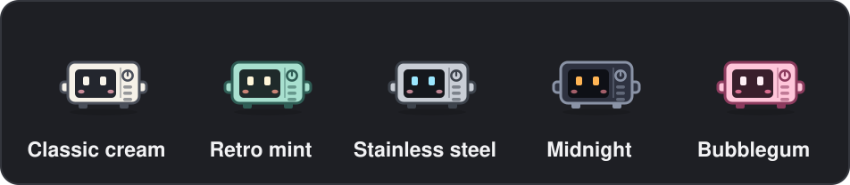

# nukey

Nukey is a little microwave with a face in its window. It lives in a band above your Claude Code prompt, in the terminal and in the desktop app, and acts out whatever Claude is busy with: reading files, cooking up code, hunting through a codebase, taste-testing, and so on. When Claude finishes, it goes **DING!**

A control panel beside it shows how full the context window is and how much of your rate limits you have used.



## Install

```bash
claude plugin marketplace add arifamir/nukey
claude plugin install nukey@nukey-kit
```

Nukey shows up in your next Claude Code session. To stay current, run `claude plugin update nukey@nukey-kit`, or turn on auto-update for the `nukey-kit` marketplace under `/plugin` → Marketplaces.

## The /nukey command

| Type | To |
| :- | :- |
| `/nukey` | Hide Nukey, or bring it back |
| `/nukey demo` | Watch every scene, three seconds each |
| `/nukey meter` | Switch the control-panel meter off or on |
| `/nukey details` | Write the meter's percentages out next to it |
| `/nukey commands` | Show shell commands exactly as typed instead of what they are for |
| `/nukey theme` | Move on to the next colour theme |
| `/nukey theme <name>` | Pick a theme: `classic`, `retro`, `steel`, `midnight` or `bubblegum` |

Arguments work in any letter case, and an unknown one gets a short list of what `/nukey` understands.

## What Nukey acts out

Nukey watches the tools Claude calls. Shell commands are judged by what they do, so `cat notes.md` counts as reading and `cd app && npm test` as running tests, even inside a longer chain.

| Scene | Label | When |
| :- | :- | :- |
| thinking | Thinking it over | Claude is reasoning between steps |
| talking | Plating up the answer | Claude is writing its reply |
| reading | Reading through the files | `Read`, or `cat`, `head`, `tail`, `jq`, `sed -n` and friends |
| coding | Cooking up some code | `Edit` or `Write` on code, `sed -i`, or a shell redirect into a file |
| writing | Writing it all down | Edits to prose: Markdown, plain text, `README`, `CHANGELOG` |
| designing | Decorating the design | Stylesheets, SVGs, design and diagram tools or skills, a new artifact |
| memory | Noting it on the fridge | Edits to `CLAUDE.md`, `MEMORY.md` or memory files |
| searching | Hunting through the code | `Grep`, `Glob`, or `grep`, `rg`, `find`, `ls` |
| web | Looking it up online | Web fetch and search, browser tools, `curl`, `wget` |
| terminal | Running a command | Any other shell command |
| testing | Taste-testing | `npm test`, `pytest`, `vitest`, `cargo test`, `go test`, `make test` and more |
| git | Stacking up git work | `git` and `gh`, wherever they appear in a chain |
| installing | Bringing in the groceries | `npm install`, `pip install`, `uv add`, `brew install` and more |
| delegating | Sending in the helpers | Subagents and workflows. The line underneath counts them, such as `2 helpers: 1 reading, 1 running tests` |
| planning | Planning the steps | Plan mode and task lists |
| skill | Picking up a new skill | Loading a skill (Nukey puts on a chef's toque) |
| sharing | Serving something up for you | Artifacts and files sent to you |
| asking | Needs your input | Claude asks you a question |
| permission | Waiting for your OK | A permission dialog is open |
| waiting | Waiting on something in the oven | Background commands, timers, or work still running after the turn |
| tool | Using a kitchen tool | Any other tool |
| compacting | Making room in the fridge | The conversation is being compacted |
| error | Something got burnt | A tool call failed, or the turn ended on an API error |
| done | Ding! All done | The turn is over |
| idle | Nukey is napping | Nothing going on |

Each scene stays up for at least a moment, so quick calls don't flicker past.

## The meter

The control panel fills up as you go:

- **Power bars:** the context window.
- **Five big buttons:** the 5-hour rate limit.
- **Seven small buttons:** the weekly rate limit.

The last two units of a gauge turn red once it passes 85%. On accounts without rate-limit windows only the power bars show.

| Meter | With `/nukey details` |
| :- | :- |
|  |  |

## Themes



| Theme | Look |
| :- | :- |
| `classic` | Cream body and Claude-orange power bars (the default) |
| `retro` | 1950s mint green with warm eyes |
| `steel` | Stainless steel with ice-blue eyes |
| `midnight` | A dark body with amber eyes |
| `bubblegum` | Pink all over |

The theme colours Nukey, its helpers and the meter, and Nukey remembers your pick across sessions.

## Privacy

Nukey makes no network requests and sends nothing anywhere. It reads what Claude Code already tells plugins on your machine: the tools Claude calls and their arguments, the context window's size and your rate-limit usage. It uses these only to pick a scene and fill the meter. The only thing it saves is your chosen theme, kept in Claude Code's own plugin storage on your machine. Everything else lasts only for the session.

## Development

```bash
claude --plugin-dir ./plugins/nukey                   # run Claude Code with Nukey loaded from disk
claude plugin test plugins/nukey                      # run the tests
claude plugin validate plugins/nukey                  # check the manifest and hooks
```

The README images are drawn by `scripts/render-demo.mts` at the root of the repository.

How the code is laid out:

| Path | Role |
| :- | :- |
| `hooks/register.tsx` | The hooks: feeds engine events to the state machine and draws the band |
| `hooks/machine.ts` | The state machine that decides which scene shows, and for how long |
| `hooks/classify.ts` | Rule tables that turn a tool call or shell command into a scene |
| `hooks/detail.ts`, `hooks/stream.ts` | The line under the label, and reading tool calls while they stream in |
| `hooks/command.ts` | The `/nukey` command and its replies |
| `hooks/art/` | Nukey, the 25 kitchen props, the terminal frames and the meter |
| `hooks/themes.ts` | The five colour themes |

Editor types appear under `.claude-plugin/types/` when Claude Code loads the plugin with `--plugin-dir`. They are generated, so they are not committed.

---

An unofficial community project, not affiliated with or endorsed by Anthropic.
